# Room Planner

Room Planner lets you lay out a room in 2D, check that the furniture fits (walkways, drawers, door swings) and look at the
result in 3D. It is free and runs entirely in your browser: no account, no API keys, no backend. Your project is saved in
the browser's own storage, and you can turn a photo of your own furniture into a simple 3D item at its real size.

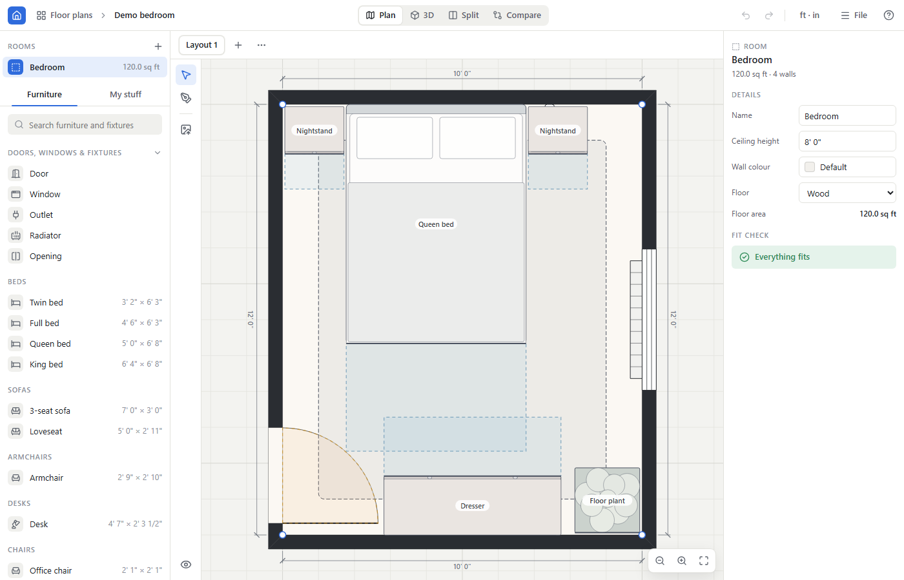

## Setup

Requires Node.js and npm.

```sh
npm install          # also copies the ONNX Runtime WASM files to public/ort
npm run dev          # http://localhost:5173
```

Offline-capable build (the service worker only exists in the production build):

```sh
npm run build && npm run preview
```

### Desktop app (Windows)

A double-clickable Windows app (Tauri 2, uses the WebView2 runtime built into Windows 10/11). It runs fully offline:
no server, nothing stored in your Chrome/Edge profile, and the photo models are bundled, so it never touches the network.

Prerequisites (one-time): Node.js, Rust via [rustup](https://rustup.rs) (MSVC toolchain), and Visual Studio Build Tools
with the "Desktop development with C++" workload (MSVC **and** a Windows 10/11 SDK).

```sh
npm.cmd run dist:win    # run from PowerShell or cmd (Git Bash's own link.exe shadows the MSVC linker)
```

This downloads the two models into `public/models/` if they are missing (about 160 MB, not committed), then builds
`src-tauri/target/release/bundle/nsis/Room Planner_<version>_x64-setup.exe`. Run it to install (per user, no admin):
it adds "Room Planner" to the Start menu and the desktop. Your project is stored in
`%LOCALAPPDATA%\com.roomplanner.desktop\EBWebView` (uninstalling offers to delete it); use File → Export to keep a copy.

`npm run desktop` opens the app in a window against the dev server, and `npm run e2e:desktop` smoke-tests the built exe.

Tests:

```sh
npm test                          # unit tests (Vitest)
npx playwright install chromium   # one-time, for the browser tests
npm run e2e                       # end-to-end tests (Playwright; starts the dev server itself)
```

The e2e run also regenerates the screenshots in `docs/screenshots/`. The two "live ML" photo tests download models from
huggingface.co and are skipped when it cannot be reached.

## Feature tour

### Your floor plans
Room Planner opens on the **Floor plans** home screen. Each floor plan (an apartment, a house, a single room) holds any
number of rooms, and every plan is saved on this device. Cards show a thumbnail of the room outlines, the number of
rooms, the total floor area and when you last edited it; the **⋯** menu opens, renames, duplicates, exports
(`.roomplan`) or deletes a plan. **New floor plan** offers three starting points (enter dimensions, draw it, trace an
image) or a blank plan; **Try the demo** adds a furnished demo bedroom; **Import** adds a `.roomplan` file as a new plan.
The last plan you had open reopens on the next visit.

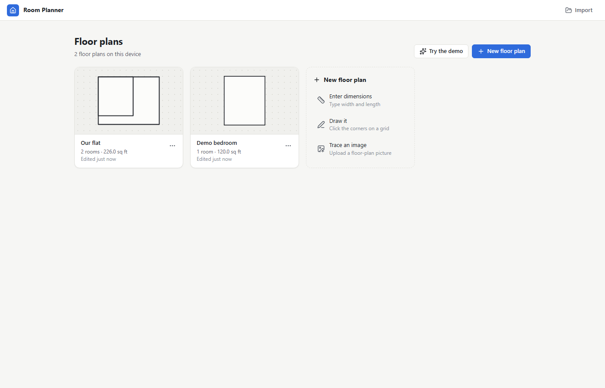

### The editor at a glance
- **Top bar:** "Floor plans › *plan name*" (click *Floor plans* to go back; click the name to rename the plan), the view
  switcher (Plan / 3D / Split / Compare, keys 1-4), undo/redo, the units switch, the **File** menu (new plan, import,
  export `.roomplan`, export PNGs) and help.
- **Tool rail** (left edge of the canvas, icons with tooltips): Select, Draw room, Trace plan, and at the bottom
  **Display** (eye icon: grid, snapping, clearance zones, cut-away walls, walk mode).
- **Left sidebar:** the plan's **Rooms** (click one to work on it, double-click or the pencil to rename, bin to delete,
  **+** next to the heading for the three ways to add one) above the **Furniture** catalogue (searchable; it starts with **Doors, windows & fixtures**) and **My stuff**.
- **Above the canvas:** the active room's layouts as tabs, **+** for a new one and **⋯** to rename, duplicate or delete it.
- **On the canvas:** only controls for that view: zoom and fit (plan, bottom right), Overview / Walk / Top view (3D, top left).
- **Inspector** (right): details of whatever is selected; with nothing selected, the room's details and its **Fit check**.

### Set up a room (three ways)
A new, empty plan shows a small "Add your first room" card (the Rooms list's **Add room** menu offers the same):
- **Enter dimensions**: type width, length and ceiling height; you get a rectangular room.
- **Draw a room**: click corners in the plan. The point follows the mouse and only snaps when a target is within about
  10 screen pixels (at any zoom): other rooms' corners and walls, dashed alignment guides through the corners you already
  placed, and a wall within 8° of horizontal/vertical straightens (a small coloured marker says what it snapped to; hold
  Alt, or Shift, for no snapping). A hint bar above the plan says what to do next and shows the current wall length and
  area; click the green circle on the first corner or press Enter to finish, Backspace (↶ Undo point) removes the last
  corner, Esc cancels. Wheel zoom and drag / Space + drag / middle-drag panning keep working while drawing.
- **Import a floor plan**: opens the **Trace floor plan** panel, docked beside the plan (it never blocks it), with five
  numbered steps:
  1. *Add your plan*: drop an image (a listing screenshot is fine) onto the plan area or choose a file; set its opacity
     or hide it.
  2. *Set the scale*, one of three ways: **measure a known length** (click both ends of something you know and type its
     length; nothing labelled? an interior door is about 30–32 in / 80 cm wide), **I know the total area** (type the
     listed area, e.g. `531 sq ft` or `49 m²`; after tracing, the plan and every room are scaled together so the rooms
     you tick add up to it; listings usually measure to the outside of walls and leave out balconies, which start
     unticked), or **skip for now**. The panel shows the scale in plain words ("1 ft ≈ 19 px on your image").
  3. *Trace rooms*, one at a time: while tracing over the plan, corners also snap to the plan's wall lines (the edge
     between dark wall ink and paper), and a 3× magnifier follows the cursor. When a room closes the panel asks its
     name (Bedroom, Bathroom, Kitchen, Living room, Closet, Hallway, Balcony, or type one), then **Trace next room** or
     **Done tracing**. The list shows each room's area, the running total and, with a listed area, the difference in %;
     rename any room there at any time (pencil, or double-click its name).
  4. *Doors & windows*: click a wall where the plan shows a gap (**Add a door / window / an opening**).
  5. *Check & fix*: drag corners (they snap the same way), click a wall to type its exact length or split it, then
     **Finish**.

  The plan stays visible under the rooms while you work; it is never included in PNG exports. **Trace plan** in the tool
  rail reopens the panel.

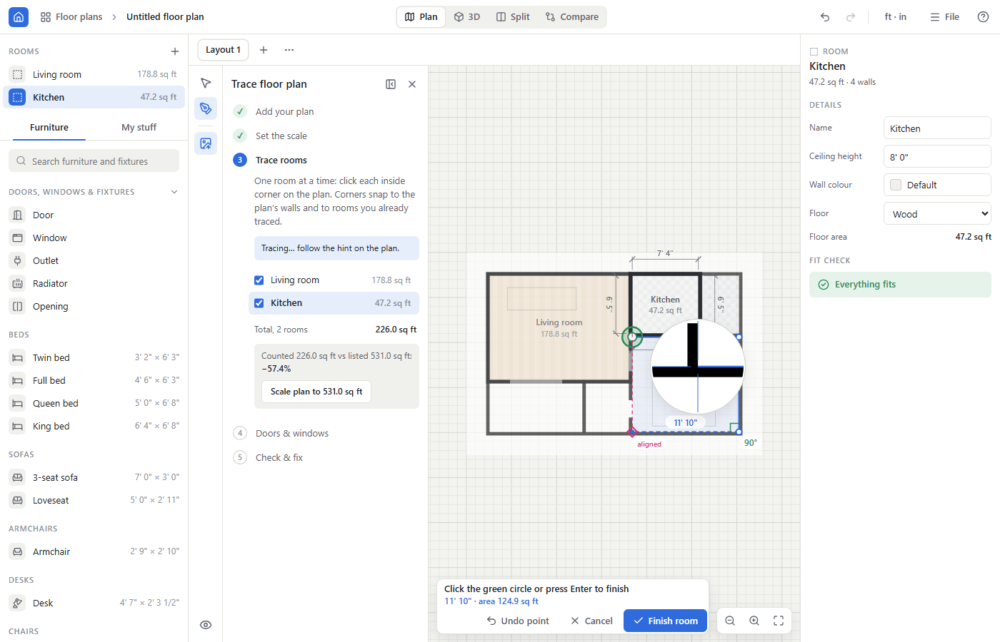

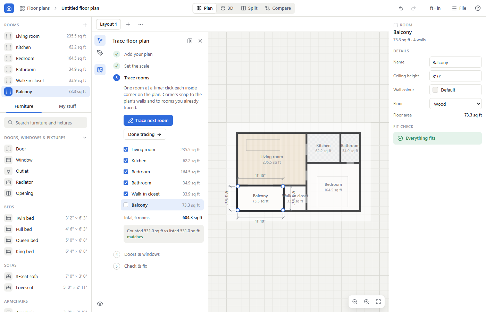

Or load the **demo bedroom** to look around first. A floor plan can hold several rooms (the **Rooms** list in the
sidebar).

### Openings and room details
Pick a door, window, outlet, radiator or **Opening** under **Doors, windows & fixtures** at the top of the Furniture tab and click a wall to place it; click one to edit it in the inspector: width, height,
sill height, offset along the wall, and for doors the hinge side and swing direction (in/out). Widths are kept between 5 cm
and the length of the wall, and the opening stays on its wall. An **Opening** is a gap with no wall at all (no door, floor
to ceiling; walk mode passes through it), e.g. where a room opens straight into the next one; it never overlaps another
opening. To remove a whole wall, click it and choose **Open this wall** in the inspector (**Close this wall** puts it back). The room inspector sets the name, ceiling height, wall
colour (a palette of interior colours, or **Custom…** for any colour) and floor (wood, carpet or tile) and shows the floor area.

### Units
The "ft · in" / "m · cm" button in the top bar switches the display between imperial and metric. Everything is stored in centimetres,
so switching never changes the plan. Length fields accept things like `6' 2"`, `75in`, `190cm`, `1.9m`; plain numbers
mean feet/inches or centimetres depending on the field and unit system. Invalid input is flagged next to the field.

### The 2D editor
- Drag an item to move it; it snaps to walls and to other items (Alt while dragging, or Display → Snapping, turns snapping off).
  Distances to the walls are shown while dragging.
- Drag the rotate handle to rotate in 15° steps (Shift: free rotation).
- Every room of the project is shown: the active one normally, the others dimmed with their name and area; click a
  dimmed room to make it active. Door / window tools work on any room's walls.
- Drag a corner to reshape the room (it snaps like drawing); double-click a wall to add a corner; select a corner and
  press Delete to remove it. Click a wall to select it: the inspector shows its length, and typing a new length moves
  the wall's end corner along the wall (a rectangle stays a rectangle) as one undo step; **Split wall** adds a corner in
  its middle.
- Mouse wheel zooms; drag the background, middle-drag or Space + drag pans; the fit button (bottom right) re-centres the room.
- The inspector shows the selected item's **Colour** (one swatch per part the item actually has, named for it: a bed's
  frame, sheets, blanket and pillows, a sofa's upholstery, cushions and legs; pick from the palette, **Custom…**, or
  **Reset to default**), its position and rotation, and Rotate 90°, Duplicate and Delete. Colours belong to that placed
  item only (a duplicate keeps them); each pick is one undo step.

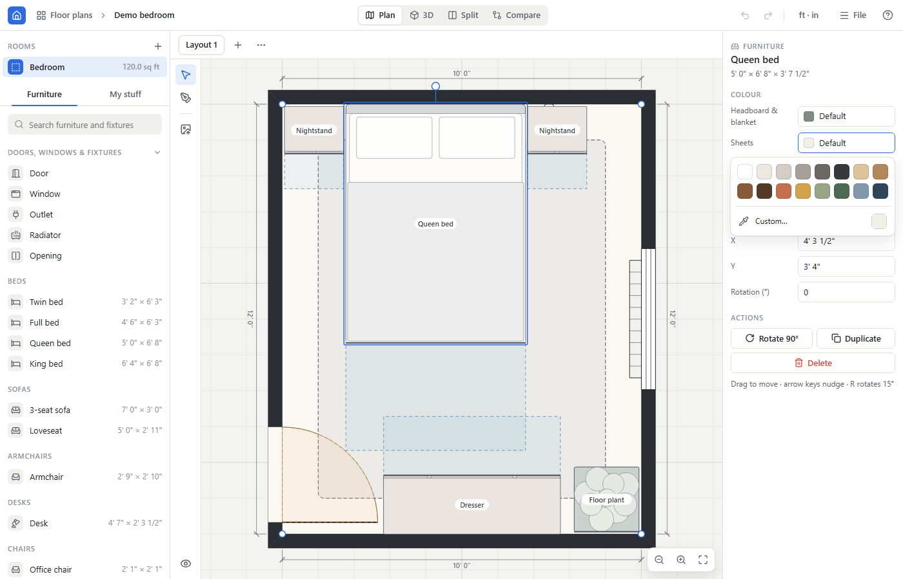

### Library and My stuff
The **Furniture** tab lists 25 parametric presets (beds, sofas, desks, dressers, rugs, lamps, plants, TV...) by category
with their footprint; type in the search box to filter, click one to place it. **My stuff** holds your own items: create one from a photo (see below) or without a photo,
then place, edit, rename or delete it. My stuff is shared by all your floor plans. Deleting an item removes it from My stuff and from every room of the open plan; another plan that still uses it keeps (and re-adds) it.

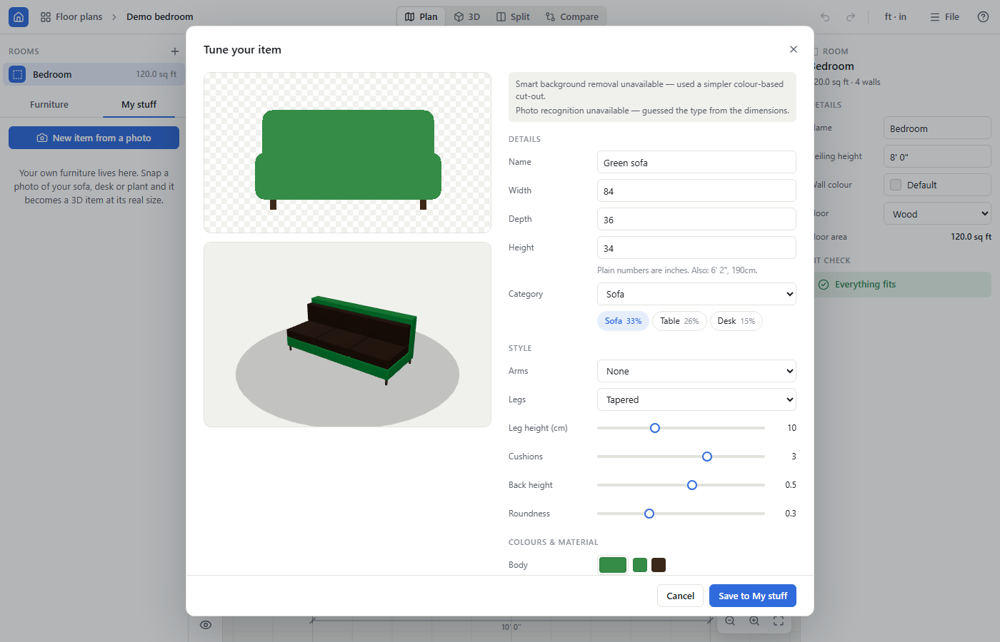

### Clearance checking
Items carry clearance zones (walkway beside a bed, drawer pull-out, chair push-back...) and doors have swing areas. The
**Fit check** in the inspector lists every problem: overlapping items, items crossing a wall, blocked clearances and blocked
door swings. Problem items are drawn red in both 2D and 3D, with the blocked zone in red; hover or select one to see why.
Display → Clearance zones (key C) hides only the neutral zones; real problems always stay visible.

### 3D view, walk mode, cutaway
The 3D view is a realistic render (PBR materials, soft shadows) of every room of the house (the active layout of each). It opens in **Overview**
mode: left-drag orbits, right-drag or Shift + drag pans, the wheel zooms, **Top view** looks straight down, and clicking an
item selects it. Double-click the floor to start walking right there. **Cut away walls** (Display menu) hides the walls between the camera
and the room.

**Walk mode** (the Walk button over the 3D view): click the view to capture the mouse and look around (drag to look if mouse capture is unavailable);
WASD or the arrow keys move, Shift sprints, Space jumps. You collide with walls and furniture and can walk through
doorways and open gaps from room to room. The first Esc releases the mouse; a second Esc (or O) returns to Overview.

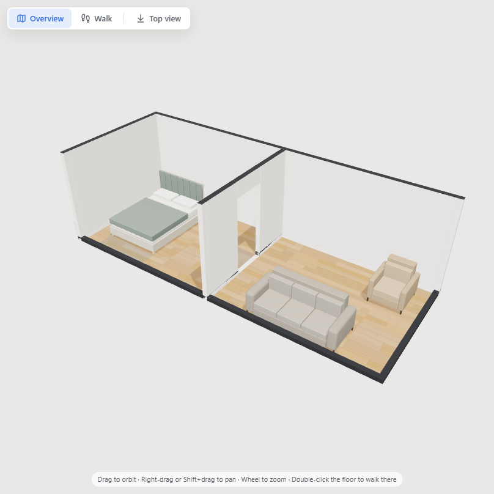

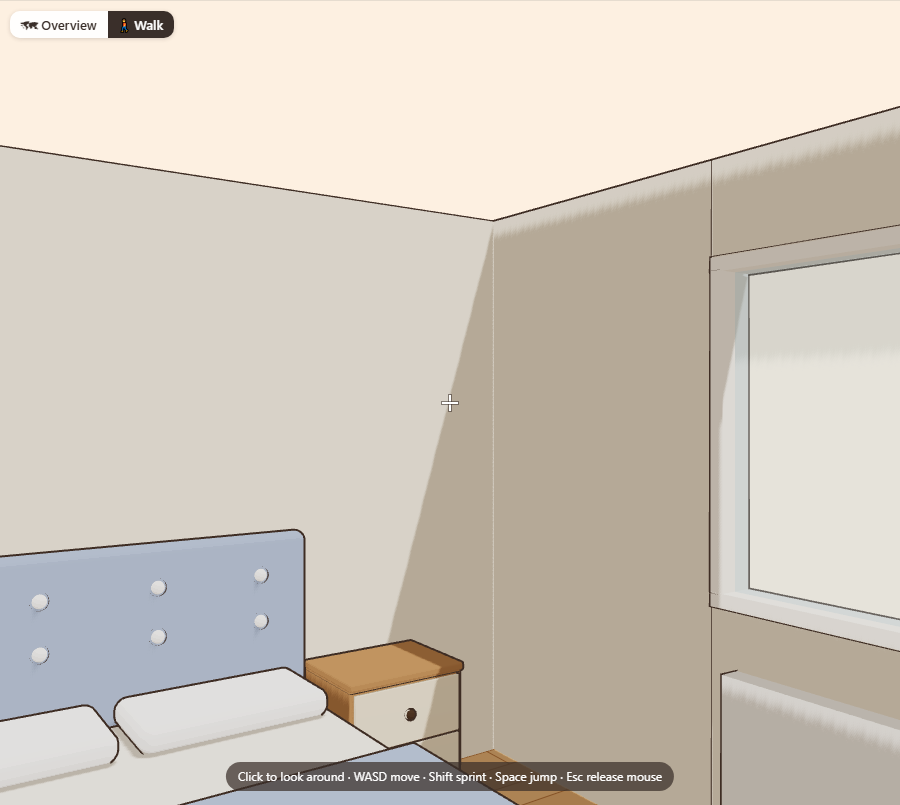

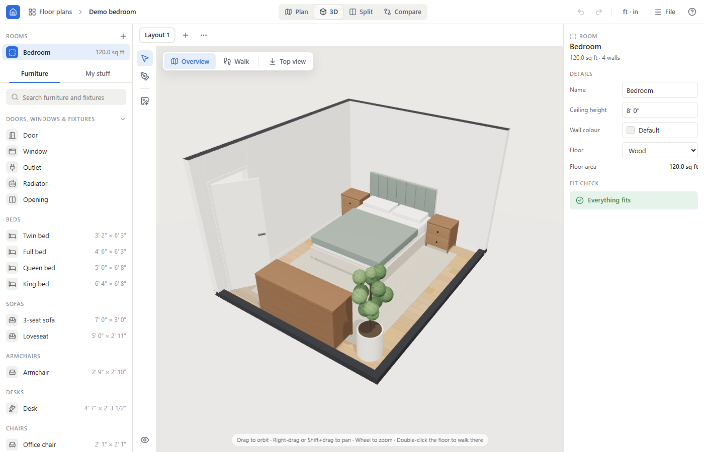

**Split** shows the plan and 3D side by side; both edit the same layout.

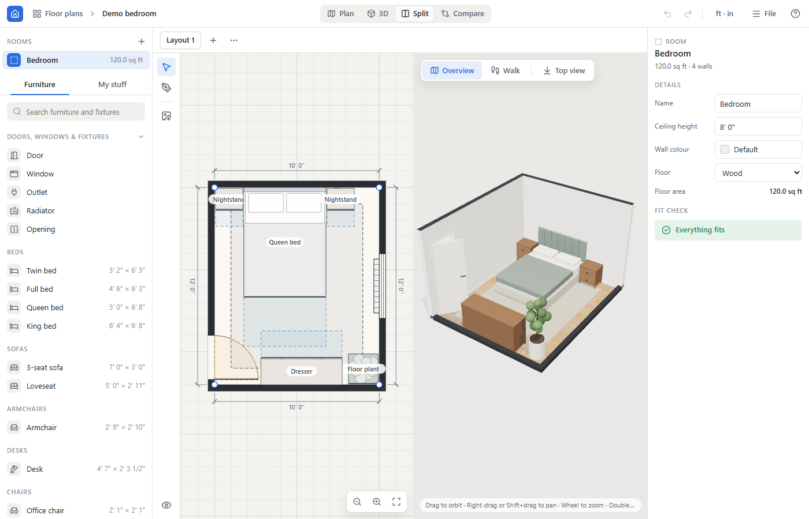

### Layouts and compare
Each room can have several layouts (the tabs above the plan): **+** adds one, **⋯** renames, duplicates or deletes the
current one (double-clicking a tab renames it too).
**Compare** shows two layouts side by side, in 2D or 3D, with the right-hand one read-only.

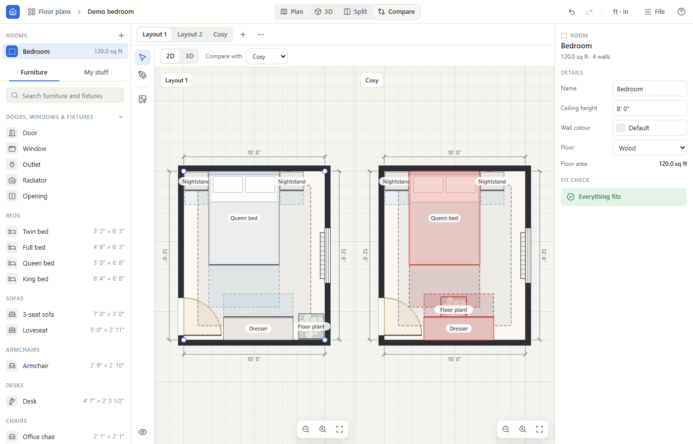

### Undo, shortcuts, autosave
- Undo/redo covers every change to the project (up to 100 steps; a drag counts as one step).
- Keyboard: Ctrl/Cmd+Z undo, Ctrl/Cmd+Shift+Z or Ctrl/Cmd+Y redo, Delete/Backspace delete, Ctrl/Cmd+D duplicate,
  R / Shift+R rotate 15°, arrow keys nudge 1 cm (Shift: 10 cm), V select tool, G grid, S snapping, C clearances,
  1-4 Plan/3D/Split/Compare, Esc deselect, ? help (the help overlay lists all keys and mouse gestures).
- Every floor plan is autosaved to the browser's IndexedDB about half a second after each change; the last one you had
  open reopens on the next visit. Clearing the site data deletes them, so export anything you want to keep.

### Export and import
- **File → Export .roomplan** saves the open floor plan as a single `.roomplan` file (a zip of `project.json` plus your
  photos and floor-plan image); the card menu on the home screen exports any plan. **Import .roomplan** adds the file as
  a new floor plan (it never replaces one) and opens it.
- **File → Export plan as PNG** renders the plan (room plus every item, even ones outside the room; no grid, underlay or
  selection handles). **Export 3D view as PNG** saves the current 3D camera view.

## How photo → model works

Everything runs in the browser on the CPU (WebAssembly). Each stage has a fallback, so a failure never blocks you.

| # | Stage | How | Fallback |
|---|---|---|---|
| 1 | Background removal | U-2-Netp (`BritishWerewolf/U-2-Netp`, Apache-2.0, fp32, ~4.6 MB) via transformers.js 4.3.2 | colour-based flood fill from the photo border; else the whole photo |
| 2 | Colour palette | k-means (k = 5) in CIELAB over the cut-out pixels | none needed (plain JS) |
| 3 | Category | zero-shot CLIP (`Xenova/clip-vit-base-patch32`, MIT, 8-bit quantized `q8`) over 14 category prompts, re-weighted by the dimensions you entered | a guess from the entered width/depth/height; else you pick |
| 4 | Material | rules on colour and texture statistics (warm brown → wood, grey/silver or shiny → metal, dark and shiny → leather, bright saturated and uniform → plastic, otherwise fabric) | fabric |
| 5 | Part colours | per-category rules: dominant colour → body, lighter colour of the same hue → cushions, darkest / wood-like → frame, most saturated leftover → accent | default colours |

- The models are downloaded once from the Hugging Face hub the first time you analyse a photo (about 160 MB in total; the
  CLIP files are about 150 MB) and are then kept in the browser's Cache API. The item creator shows the download progress
  in % and MB. A slow download is fine: it only gives up after 30 s without any progress (or 10 minutes overall). If
  the network is blocked it falls back straight away.
- **Skip — I'll pick the type myself** (shown during analysis) goes straight to the editing step with the fallbacks;
  the download carries on in the background for next time.
- After the first successful download, analysis also works offline in the production build (the ONNX Runtime WASM files
  are served by the app itself and precached by the service worker).
- The result is a **parametric 3D model** of the chosen category, built at exactly the dimensions you entered and
  coloured from the photo. You can change the category, style options, each part's colour and the material before saving.
  It is not a 3D scan of your furniture.

## Project structure

| Directory | Contents |
|---|---|
| `src/types.ts` | shared types and conventions (cm, plan coordinates, rotation) |
| `src/core/` | pure geometry, units, snapping, collision and clearance checks |
| `src/store/` | Zustand store, undo/redo, IndexedDB autosave and blob store, `.roomplan` import/export, demo room |
| `src/editor2d/` | SVG plan editor and 2D PNG export |
| `src/floorplan/` | floor-plan underlay, calibration, wall-ink snapping, the docked tracing panel |
| `src/models/` | parametric furniture generators, presets, PBR materials |
| `src/photo/` | photo pipeline and the item creator dialog |
| `src/view3d/` | react-three-fiber scene: room, items, orbit and walk cameras, cutaway, overlays, 3D PNG export |
| `src/app/` | app shell: floor-plan home screen, top bar, tool rail, sidebar, inspector, layouts bar, dialogs, shortcuts |
| `e2e/` | Playwright tests (and the screenshot generator) |

See [ARCHITECTURE.md](ARCHITECTURE.md) for the data flow and module boundaries.

## Known limitations

- One polygon per room: no interior walls, columns, stairs or multiple floors in a room. Openings are placed on the room's
  own walls only.
- Snapping to the plan's walls needs dark (black or dark grey) wall lines; pale walls are not recognised.
- The listed-area figure and the tracing step are remembered only until the page is reloaded
  (the rooms and the plan image are saved as usual). Matching a listed area does not move doors already placed.
- The first photo analysis needs a one-time download of about 160 MB, and recognition runs on the CPU, so it can take a
  while on slow machines.
- Category and material guesses are heuristics and can be wrong; both are always editable before saving.
- Offline use requires the production build (`npm run build && npm run preview`, or a deployed build) and one online visit
  first; the dev server does not work offline. Photo recognition offline also needs one earlier successful analysis.
- Data lives only in this browser: no accounts, no sync between devices; use export/import to move a floor plan.
- No AR, LiDAR import or photo-to-mesh; photo items are parametric approximations.
- Items are boxes for collision and clearance purposes (their footprint rectangle), and heights are not considered when
  checking overlaps (e.g. a chair under a table counts as overlapping). Rugs are the only items that may be overlapped.
- Performance has only been checked on the development machine.
- Below about 700 px wide the side panels move below the view and the page scrolls; there is no dedicated touch UI.

## License

MIT. See [LICENSE](LICENSE).
